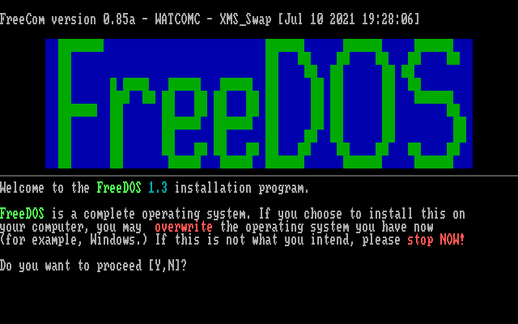
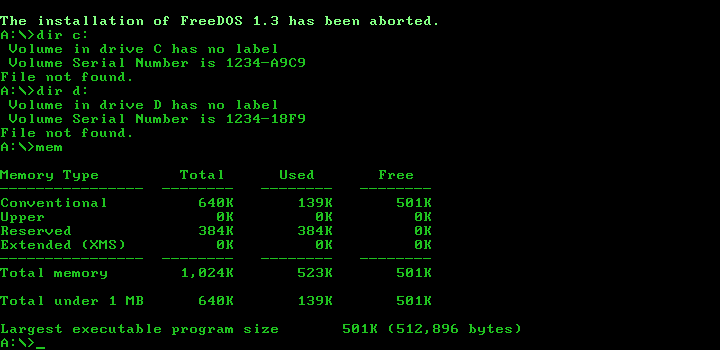
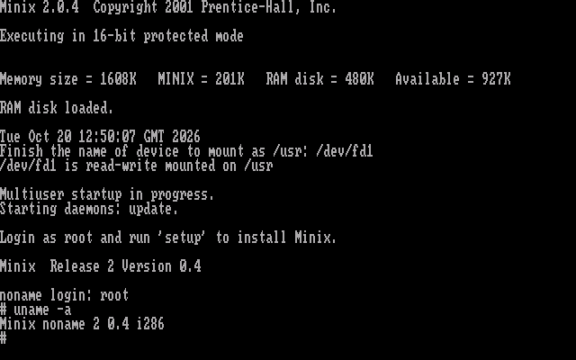
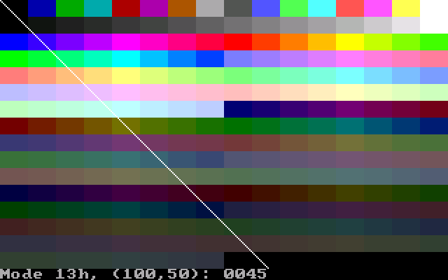
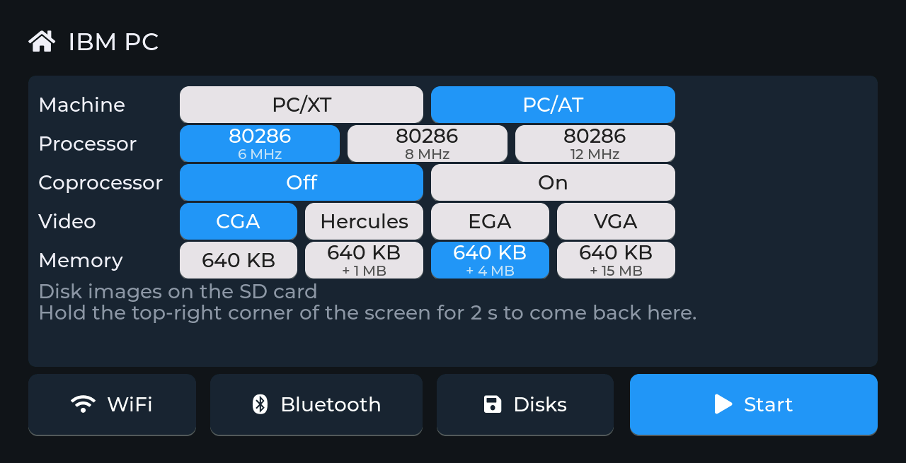

<h1 align="center">esp32pc</h1>

<p align="center">
  <b>An IBM PC on an ESP32-S3 or ESP32-P4 board.</b><br>
  The PC/XT (an 8088 at 4.77 MHz) and the PC/AT (an 80286 at 6 MHz, on the Tab5 also 8 and 12 MHz, with extended memory and protected mode), a CGA, Hercules, EGA or VGA card, an AdLib and a Sound Blaster, an 8087/287 coprocessor, two floppy drives and two hard disks for disk images or folders, a serial mouse, a printer port, a built-in BIOS (no ROM images needed, a real one optional), Bluetooth and USB keyboards and mice.
</p>

<p align="center">
  
  
  
  
  
  
</p>

<p align="center">
  <b>Work in progress:</b> not everything has been tested, and games and demos may or may not
  work satisfactorily.
</p>

<p align="center">
  
  
  <br>
  
  
  <br>
  <sub>FreeDOS 1.3 on the emulated PC/XT: its installer on the CGA, and the Hercules card's
  text with two blank hard disks. Minix 2.0.4 running the PC/AT's 80286 in protected mode,
  and the VGA's 256 colours (a test program). All from the desktop build of the same
  emulator (<code>components/ibmpc/host</code>).</sub>
</p>

esp32pc turns a Makerfabs MaTouch ESP32-S3 7" or an M5Stack Tab5 into an
IBM PC/XT: an **8088** at 4.77 MHz with the PC's own chips (the **8259**
interrupt controller, the **8253** timer, the **8255** and its keyboard,
the **8237** DMA controller, the **765** floppy controller) and 256 to
640 KB, or an 8086 at 8 MHz as the turbo XTs had; or a PC/AT: an
**80286** at 6 MHz (on the Tab5 8 and 12 MHz too) with its protected mode,
the **8042** keyboard
controller with the A20 gate, the **MC146818** clock, two 8259s and two
8237s, the AT's hard disk controller, and up to 2 MB (MaTouch) or 15 MB
(Tab5) of extended memory. Each has a **CGA**, a
**Hercules** card, an **EGA** or a **VGA**, an **AdLib** and a **Sound
Blaster**, optionally an **8087** or **287** coprocessor, a Microsoft
serial mouse on COM1 and a printer on LPT1 (whose pages land in a file on
the card). Disk images on the microSD card go into two floppy drives and
two hard disks; blank ones come formatted, hard disks from 10 to 128 MB; a
folder of files on the card can be a hard disk too. A
Bluetooth or USB keyboard types, a Bluetooth or USB mouse (or a finger on
the panel) moves the pointer, a setup screen on the touch panel and a web
page on your network handle the rest.

No ROM images are needed: the BIOS is part of the emulator, written for
it. It has IBM's entry points and tables where programs look for them, and
it works the emulated chips through their ports, as the real one does. A
real BIOS ROM can be used instead (an open source one such as
[GLaBIOS](https://github.com/640-KB/GLaBIOS), or your own).

It's a sibling of
[esp32ste](https://github.com/rlucencic/esp32ste) (Atari STE),
[esp32mac](https://github.com/rlucencic/esp32mac) (Macintosh Plus, SE, Classic),
[esp32mac2](https://github.com/rlucencic/esp32mac2) (Macintosh LC and II),
[esp32mac3](https://github.com/rlucencic/esp32mac3) (Macintosh LC II and LC III),
[esp32arc](https://github.com/rlucencic/esp32arc) (Acorn Archimedes),
[esp32cpc](https://github.com/rlucencic/esp32cpc) (Amstrad CPC),
[esp32zx](https://github.com/rlucencic/esp32zx) (ZX Spectrum),
[esp32cbm](https://github.com/rlucencic/esp32cbm) (Commodore 64 and 128),
[esp32xl](https://github.com/rlucencic/esp32xl) (Atari 800XL and 130XE),
[esp32msx](https://github.com/rlucencic/esp32msx) (MSX1 and MSX2),
[esp32gs](https://github.com/rlucencic/esp32gs) (Apple IIGS) and
[esp32coco](https://github.com/rlucencic/esp32coco) (Tandy Color Computer 2
and 3); all are built on the shared runtime
[esp32emu](https://github.com/rlucencic/esp32emu), which also holds the
x86 core.

## What works

- **The 8088**: every instruction, documented or not, with the flags the
  chip really leaves, checked against the 3 million hardware-recorded tests
  of the [SingleStepTests 8088 suite](https://github.com/SingleStepTests/8088)
  (and the 8086 model against its own); its speed from the documented clock
  counts and a model of its prefetch queue.
- **The 80286**: its own instructions, faults and timing, checked against
  the 1.5 million tests of the 286's real mode suite (all but 17 pass); and
  its **protected mode**: descriptor tables, segment limits and rights, the
  four privilege levels, call, interrupt, trap and task gates, task
  switches, exceptions with their error codes, the double fault and the
  shutdown that brings a program back to real mode, and LOADALL. Minix 2's
  16-bit kernel runs on it, with its own floppy and hard disk drivers.
- **The PC/XT**: its interrupt controller, timer (the 18.2 Hz tick, the
  speaker's channel) and keyboard port; its memory map.
- **The PC/AT**: extended memory (FreeDOS's FDXMS286 XMS driver and DOS
  in the HMA work), the keyboard controller (A20 gate, the
  CPU's reset), the CMOS clock with the board's time, the second interrupt
  and DMA controllers, the hard disk controller (the WD1003's registers, as
  IDE drives answer them), the BIOS's extended memory and protected mode
  services (INT 15h AH=87h, 88h, 89h).
- **CGA and Hercules**: drawn from the 6845's registers, so programs that
  set up their own timings show as on the cards (palette and mode changes
  in the middle of the picture too); their status registers follow the
  beam. Hercules graphics (720 x 348) as well as its text.
- **EGA and VGA**: 256 KB in four planes with the cards' logic (latches,
  the write and read modes, the bit mask), drawn from their registers as
  the hardware does it, so tweaked modes show as on the cards: mode 13h,
  mode X, 640 x 480 in 16 colours, 80 x 50 text, the split screen,
  panning, the VGA's DAC; and their BIOS (with its video ROM at C0000h).
  Commander Keen 1 and 4 run at full speed on both boards, Wolfenstein 3D
  on the Tab5 (83-93% on the MaTouch in its 3D view), and OpenGEM's
  desktop.
- **The floppy controller and DMA** for programs that drive them
  themselves, and **a Microsoft serial mouse** on COM1.
- **Disks**: floppies of 160 KB to 2.88 MB (`.img`, `.ima`, `.vfd`), hard
  disks (`.hdd`, `.vhd`, or a large `.img`) up to 504 MB. FreeDOS's `SYS C:`
  (or DOS's `FORMAT C: /S`) makes a blank hard disk bootable.
- **Folders as hard disks**: a folder inside the card's `pc` folder shows
  in the drive lists as `NAME/` and goes into C: or D: as a read-only DOS
  disk of its files and subfolders (long names shortened as Windows does,
  `LONGFI~1.TXT`).
- **Files without disk images on the web page**: files, folders or a ZIP
  dropped on it are put together on one disk image in the browser (the
  smallest floppy that holds them, else a hard disk image) and uploaded.
- **The speaker**: the timer's tones and programs toggling port 61h
  themselves, as 44.1 kHz sound.
- **AdLib and Sound Blaster**: the AdLib's OPL2 (through Mitsutaka
  Okazaki's emu8950) at 388h, as games find it (its timers), and the Sound
  Blaster 2.0's DSP at 220h with its DMA and interrupt
  (`SET BLASTER=A220 I7 D1 T3`): music and digitised effects, as in
  Wolfenstein 3D.
- **The coprocessor**: an 8087 beside the XT's 8088 or a 287 beside the
  AT's 286 (on or off on the setup screen): every instruction, 80-bit values kept exactly in moves, integer
  and BCD conversions, the arithmetic exact to the last bit, exceptions
  as the chips handle them (the AT's IRQ 13, the XT's NMI).
- **The printer port**: LPT1 at 378h, INT 17h and Print Screen; what's
  printed goes into `PRINTER.TXT` in the card's `pc` folder.
- **The BIOS**: video (the CGA's and MDA's modes 0-7, the EGA's and VGA's
  up to 13h), disks, keyboard (with Alt and the keypad, Ctrl-Break,
  Ctrl-Alt-Del), the serial port, the time of day (from the board's clock),
  the boot from A: then C: (without a disk it waits for one).
- **A real BIOS instead** (in the emulator's library and its desktop
  build; on the boards it would be built into the firmware): the built-in
  BIOS's disk and video parts then come as option ROMs that its POST
  finds, as an XT's hard disk card and an EGA or VGA bring their own.
  [GLaBIOS](https://github.com/640-KB/GLaBIOS) passes its POST and boots
  floppies and hard disks.
- **The web page** shows DOS's free memory with a bar, as the other
  emulators show their systems'.
- **The debugger**: breakpoints, stepping, registers, memory and the
  disassembly from VS Code over WiFi (esp32emu's debugger and its
  extension).

Measured: every configuration each board offers runs at full speed in DOS
and the games tried, except Wolfenstein 3D's 3D view on the MaTouch
(83-93%). The PC/AT at 6 MHz (about 1.1 million instructions a second)
takes 37-57% of the Tab5's second core and 68-82% of the MaTouch's (with
the VGA too); the Tab5's 12 MHz 286 70-84%.

## Not there

No 386: programs that need one (DOS/4GW games, Windows 3.1's enhanced
mode) won't start. No Sound Blaster Pro or 16, no MIDI, no network; the
folder drives are read only. Copy-protected floppies need more of the 765's track-level
behaviour than is emulated. Timing is per instruction, not per bus cycle:
demos that count cycles won't look right. The plan and the reasons for
each choice are in [docs/architecture.md](docs/architecture.md).

## Building

ESP-IDF v5.5.4, with [esp32emu](https://github.com/rlucencic/esp32emu)
cloned next to this repository:

```sh
idf.py build && idf.py -p PORT flash                                  # MaTouch ESP32-S3 7"
idf.py -B build-tab5 -DIDF_TARGET=esp32p4 \
       -DSDKCONFIG=$PWD/build-tab5/sdkconfig build flash -p PORT    # M5Stack Tab5
```

Put disk images in a `pc` folder on the microSD card (or upload them on the
web page at `http://ibm-pc.local`, which also turns dropped files and
folders into disk images), choose them on the setup screen's Disks page,
and press Start. A folder of DOS programs in the `pc` folder can go into
C: or D: as it is. FreeDOS's floppy edition is a good first disk. A
DOS mouse driver (FreeDOS's CTMOUSE, Microsoft's MOUSE.COM) finds the mouse
on COM1; on the panel a drag moves it, a tap clicks the left button and a
long press the right one.

<p align="center">
  
</p>

## Credits

- The character sets are IBM's as the
  [Ultimate Oldschool PC Font Pack](https://int10h.org/oldschool-pc-fonts/)
  by VileR reproduces them (CC BY-SA 4.0).
- The 8088's undefined flags after DIV, IDIV and the BCD instructions
  follow [MartyPC](https://github.com/dbalsom/martypc) (MIT).
- The CPU tests are Daniel Balsom's
  [SingleStepTests](https://github.com/SingleStepTests) (MIT).
- The VGA's 8x16 characters also come from the Ultimate Oldschool PC Font
  Pack; its default 256-colour palette is worked out as IBM's lays it out.
- The AdLib's OPL2 is Mitsutaka Okazaki's
  [emu8950](https://github.com/digital-sound-antiques/emu8950) (MIT).

## Licence

MIT (see LICENSE); the fonts in `components/ibmpc/font.c` are CC BY-SA 4.0.
